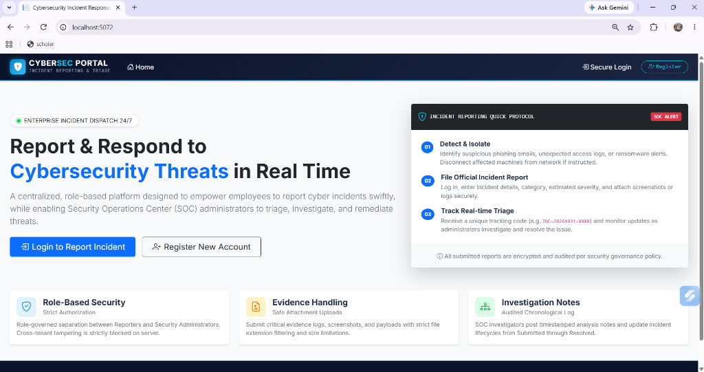
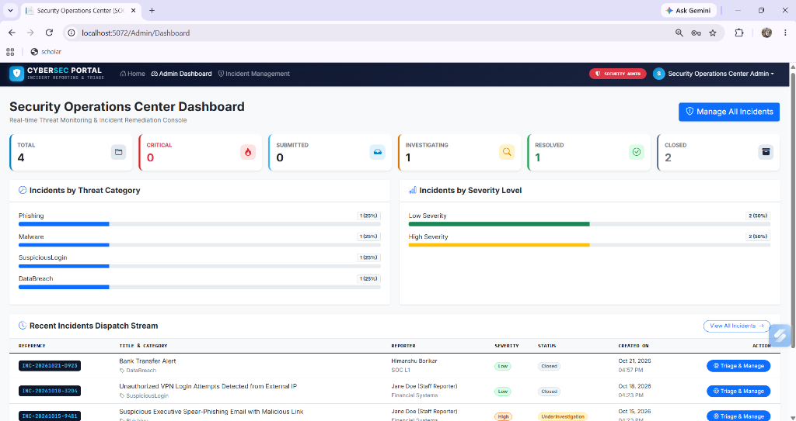
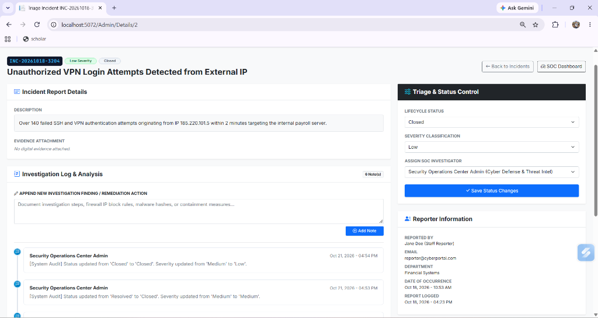
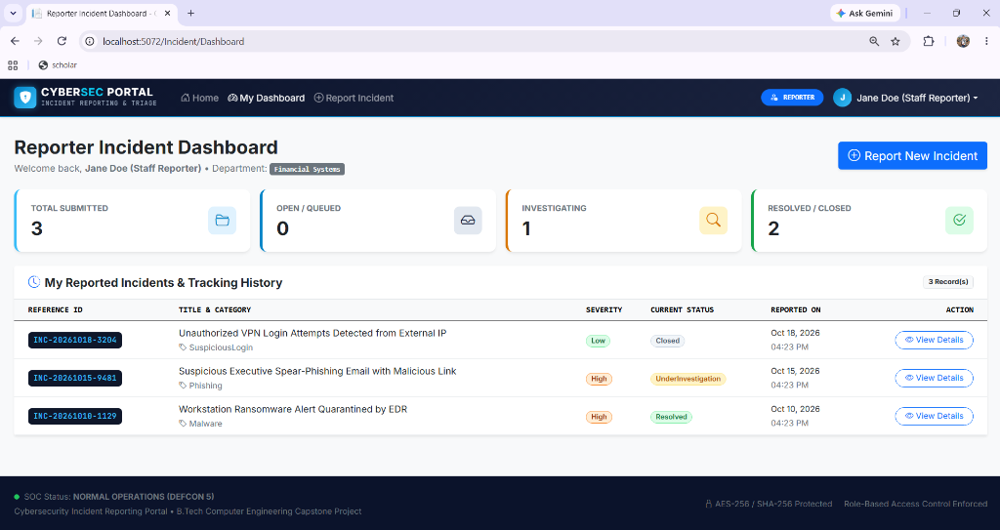
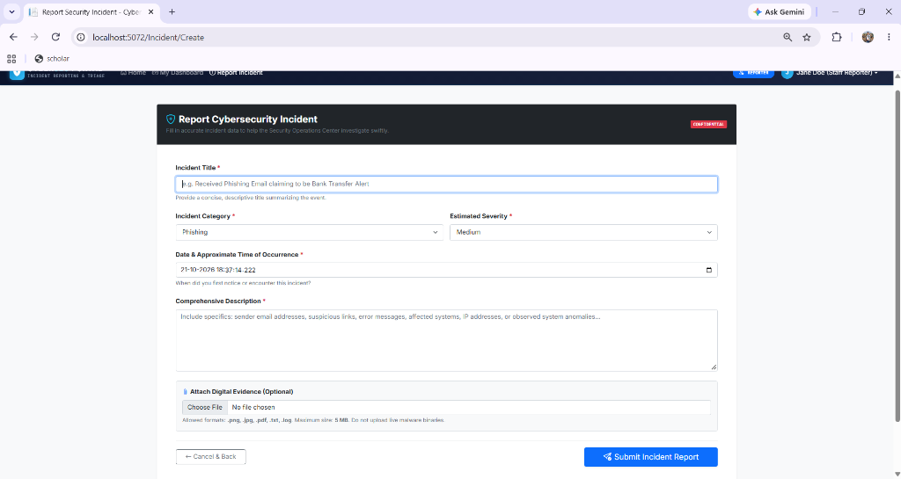
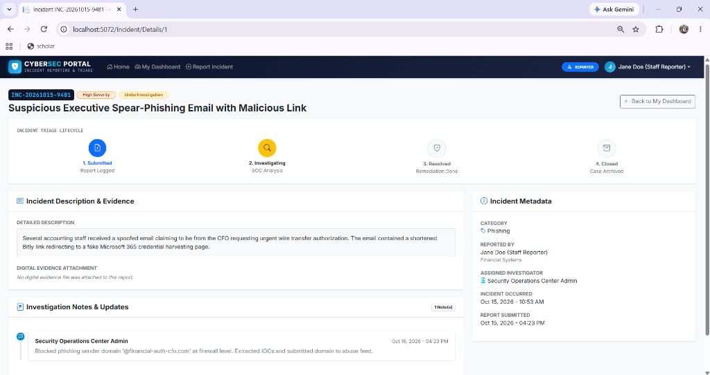
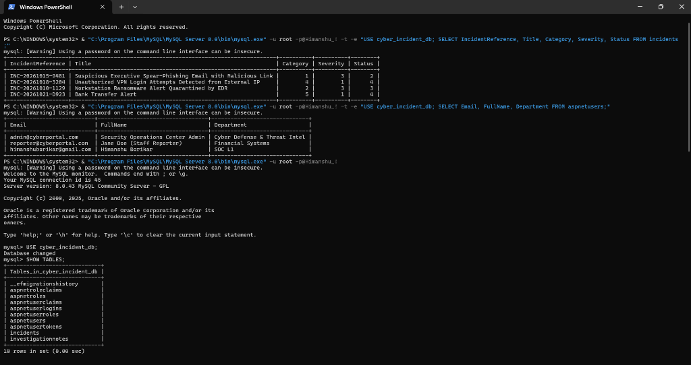
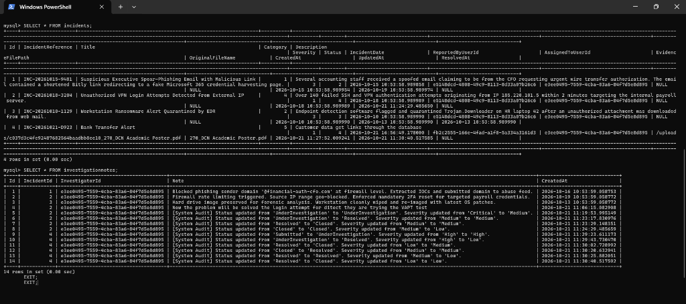

# 🛡️ Cybersecurity Incident Reporting Portal

**B.Tech Computer Engineering Mini-Project / Capstone Submission**  
Built with **ASP.NET Core 8.0 MVC**, **C#**, **Entity Framework Core 8**, **Pomelo MySQL Provider**, **MySQL 8.0 Server**, **ASP.NET Core Identity**, and **Bootstrap 5**.

---

## 📸 Project Screenshots

### 🏠 Home Page


> The landing page with quick-access protocol cards, cybersecurity branding, and CTA buttons for login and registration.

---

### 📊 Security Operations Center (Admin) Dashboard


> Real-time SOC dashboard showing live incident statistics, category distribution (Phishing, Malware, etc.), severity breakdown, and the recent incidents dispatch stream.

---

### 🔍 Admin Triage Console — Incident Details


> The full investigation console where SOC admins can update lifecycle status, reclassify severity, assign investigators, and add timestamped forensic investigation notes with a complete audit log.

---

### 📋 Reporter Incident Dashboard


> The reporter's personal dashboard showing total submitted, open, under investigation, and resolved/closed incidents with a full history table and reference IDs.

---

### 📝 Report Incident Form


> The incident submission form with category and severity dropdowns, date/time picker, comprehensive description field, and optional digital evidence file upload.

---

### 🔎 Reporter — Incident Details & Lifecycle Tracker


> The reporter's view of an individual incident, showing the 4-step visual triage lifecycle tracker (Submitted → Investigating → Resolved → Closed), incident description, evidence attachment status, investigation notes/updates from the SOC admin, and full incident metadata sidebar.

---

### 🗄️ MySQL Database — Tables & Live Data (PowerShell)


> Proof of live MySQL database connectivity. Shows `SHOW TABLES` output (18 tables including `incidents`, `investigationnotes`, `aspnetusers`), a `SELECT` query on the `incidents` table returning all 4 seeded incidents, and a `SELECT` on `aspnetusers` confirming all 3 registered accounts with roles.

---

### 📊 MySQL — Full Incidents & Investigation Notes Records


> Complete `SELECT * FROM incidents` output showing all incident fields (reference, category, severity, status, timestamps, reporter/assignee IDs, evidence file paths), followed by `SELECT * FROM investigationnotes` showing all 14 timestamped audit notes and forensic investigation entries linked to incident IDs.

---

## 🚀 How to Access This Project

### ✅ Prerequisites

Before running the project, make sure the following are installed on your system:

| Requirement | Version | Check Command |
|---|---|---|
| .NET SDK | 8.0 LTS | `dotnet --version` |
| Git | Any | `git --version` |

*(Note: SQLite is configured by default, requiring **no database server installation**. If using MySQL, MySQL Server 8.0+ is needed).*

---

### 📥 Step 1 — Clone / Open the Repository

Open a terminal (PowerShell / Command Prompt) in the project folder:

```bash
cd cybersecurity-incident-reporting-portal-main
```

---

### 🔧 Step 2 — Database Configuration (SQLite / Zero Setup)

By default, the project is configured to use **SQLite** (`cyber_incident.db`). No database installation or server is required!

The database file and required tables will be **automatically created and seeded** with default admin, reporter, and sample incident data on first launch.

In `appsettings.json`:
```json
{
  "ConnectionStrings": {
    "DefaultConnection": "Data Source=cyber_incident.db"
  }
}
```

---

### ▶️ Step 3 — Run the Application

Start the application using:

```powershell
dotnet run --launch-profile "http"
```

Or, if using **Visual Studio**, open `IncidentReportingPortal.csproj` and press **F5**.

---

### 🌐 Step 5 — Open in Browser

Once the app starts, open your browser and navigate to:

```
http://localhost:5072
```

The application should load the home page immediately.

---

### 🔑 Step 6 — Login with Demo Credentials

The database is automatically pre-seeded with two demo accounts:

| Role | Email | Password | Access Level |
|---|---|---|---|
| 🔴 **Admin (SOC)** | `admin@cyberportal.com` | `Admin@12345Cyber!` | Full system access, dashboards, triage, investigation, deletion |
| 🟢 **Reporter (Staff)** | `reporter@cyberportal.com` | `Reporter@12345!` | Submit incidents, view own reports, track status |

> You can also **register a new account** at `/Account/Register` — it will be assigned the **Reporter** role automatically.

---

### 📂 Project Folder Structure

```
CybersecurityIncidentReportingPortal/
│
├── Controllers/
│   ├── AccountController.cs       # Login, Register, Logout, Role-based redirect
│   ├── AdminController.cs         # SOC dashboard, incident management, notes
│   ├── IncidentController.cs      # Reporter dashboard, incident submission
│   └── HomeController.cs          # Landing page
│
├── Models/
│   ├── Entities/                  # ApplicationUser, Incident, InvestigationNote
│   ├── Enums/                     # IncidentCategory, IncidentSeverity, IncidentStatus
│   └── ViewModels/                # Auth, Dashboard, Incident view models
│
├── Data/
│   ├── ApplicationDbContext.cs    # EF Core DbContext with relationships & indexes
│   └── DbSeeder.cs                # Seeds roles, demo accounts, sample incidents
│
├── Views/
│   ├── Account/                   # Login, Register, AccessDenied
│   ├── Admin/                     # SOC Dashboard, Incidents list, Triage details
│   ├── Incident/                  # Reporter Dashboard, Create form, Details
│   ├── Home/                      # Landing page
│   └── Shared/                    # Layout, LoginPartial, ValidationScripts
│
├── Migrations/                    # EF Core MySQL migration scripts
├── wwwroot/                       # Static assets (CSS, JS, Bootstrap, jQuery)
├── appsettings.json               # Database connection (fill in your MySQL password)
├── appsettings.example.json       # Safe template with placeholder password
├── Program.cs                     # App startup, DI config, Identity, Middleware
└── README.md                      # This file
```

---

## 1. Project Overview & Problem Statement

In modern organizations, cyber threats such as spear-phishing, ransomware, unauthorized lateral movement, and data breaches require rapid detection, triage, and audited remediation. 

The **Cybersecurity Incident Reporting Portal** is a production-grade, centralized web application that provides:
- A clean, accessible portal for company staff (**Reporters**) to log security incidents, attach digital evidence, and track triage progress.
- A comprehensive **Security Operations Center (SOC)** dashboard for **Administrators** to analyze threat metrics, filter and triage reports, reclassify severity, add timestamped forensic investigation notes, and safely manage incident lifecycles.

---

## 2. Technology Stack

| Layer | Technology |
|---|---|
| Framework | .NET 8.0 LTS (ASP.NET Core MVC) |
| Language | C# 12 |
| ORM | Entity Framework Core 8.0.11 |
| Database Provider | `Pomelo.EntityFrameworkCore.MySql` v8.0.2 |
| Database Engine | MySQL Server 8.0 (Port 3306) |
| Authentication | ASP.NET Core Identity (PBKDF2 hashing, Anti-Forgery CSRF) |
| Frontend | Razor Views, HTML5, CSS3, Bootstrap 5, Bootstrap Icons |

---

## 3. User Roles & Pre-Seeded Test Credentials

| Role | Account Email | Default Password | Capabilities |
|---|---|---|---|
| **Administrator (SOC)** | `admin@cyberportal.com` | `Admin@12345Cyber!` | SOC metrics, triage queue, update status/severity, assign investigators, add forensic notes, delete records |
| **Reporter (Staff)** | `reporter@cyberportal.com` | `Reporter@12345!` | Submit incidents, attach evidence, view personal reports, track lifecycle, withdraw unassigned reports |

> *Self-Registration:* Any user can register a new account from `/Account/Register`; new accounts are automatically assigned the **Reporter** role.

---

## 4. Architecture & Key Features

### A. Strict Server-Side Role-Based Access Control
- `[Authorize(Roles = "Admin")]` protects all administrative triage endpoints.
- User-level authorization prevents reporters from viewing or modifying other users' incidents by altering IDs in the URL.

### B. Incident Triage Lifecycle
Every report progresses through an audited lifecycle:

```
Submitted → Under Investigation → Resolved → Closed
```

Automated system notes are logged to the audit trail whenever an incident's status or severity changes.

### C. Secure Evidence Attachment Handling
- File uploads validated for permitted extensions: `.png`, `.jpg`, `.jpeg`, `.pdf`, `.txt`, `.log`
- File size strictly capped at **5 MB**
- Uploaded files renamed with cryptographic GUIDs to prevent path traversal

### D. Real-Time SOC Metrics
- Live database counts: Total Incidents, Critical Threats, Open, Under Investigation, Resolved, and Closed
- Category distribution breakdown and severity level percentages with color-coded threat bars

---

## 5. Database Schema & Relationships

### `AspNetUsers` (Extended Identity Table)
| Column | Type | Notes |
|---|---|---|
| `Id` | string (PK) | Auto-generated GUID |
| `FullName` | nvarchar | Required |
| `Department` | nvarchar | Optional |
| `Email`, `PasswordHash`, etc. | Identity standard columns | Managed by ASP.NET Core Identity |

### `Incidents` Table
| Column | Type | Notes |
|---|---|---|
| `Id` | int (PK) | AUTO_INCREMENT |
| `IncidentReference` | nvarchar | Unique index, e.g. `INC-20261021-A1B2` |
| `Title` | nvarchar(200) | Required |
| `Category` | int (Enum) | Phishing=1, Malware=2, UnauthorizedAccess=3, SuspiciousLogin=4, DataBreach=5, Other=6 |
| `Severity` | int (Enum) | Low=1, Medium=2, High=3, Critical=4 |
| `Status` | int (Enum) | Submitted=1, UnderInvestigation=2, Resolved=3, Closed=4 |
| `ReportedByUserId` | FK → AspNetUsers | ON DELETE RESTRICT |
| `AssignedToUserId` | Nullable FK → AspNetUsers | ON DELETE SET NULL |
| `EvidenceFilePath` | nvarchar(260) | Nullable |
| `CreatedAt`, `UpdatedAt`, `ResolvedAt` | datetime | Auto-managed |

### `InvestigationNotes` Table
| Column | Type | Notes |
|---|---|---|
| `Id` | int (PK) | AUTO_INCREMENT |
| `IncidentId` | FK → Incidents | ON DELETE CASCADE |
| `InvestigatorId` | FK → AspNetUsers | ON DELETE RESTRICT |
| `Note` | nvarchar(2000) | Required |
| `CreatedAt` | datetime | Auto-managed |

---

## 6. College Viva & Evaluation Demonstration Walkthrough

1. **Home Page (`/`)** — Showcase the cybersecurity-themed UI, live DEFCON 5 status indicator, and quick action protocol.

2. **Reporter Flow:**
   - Log in with `reporter@cyberportal.com` / `Reporter@12345!`
   - View **My Dashboard** — explain personal metrics and submitted incident history
   - Click **Report Incident** — fill title, select "Phishing", severity "High", add description, upload a log file
   - Submit and show the generated reference code (e.g. `INC-20261021-XXXX`)
   - Click **View Details** — walk through the 4-step lifecycle tracker and metadata

3. **Admin / SOC Flow:**
   - Log out and sign in with `admin@cyberportal.com` / `Admin@12345Cyber!`
   - Show **SOC Dashboard** — point out live computed metrics, category distribution, severity breakdown
   - Go to **Incident Management** — demonstrate search, filters, sorting
   - Open the reporter's incident → Change status to *Under Investigation*, assign investigator, save changes
   - Add investigation note: *"Extracted malicious domain from email header; added DNS sinkhole block."*
   - Show the chronological timeline with system audit note appended automatically
   - Mark status as *Resolved* and verify the resolution timestamp is populated

4. **Security Verification:**
   - Show that reporters cannot access `/Admin/Dashboard` — system returns 403 Access Denied
   - Show that a reporter cannot view another user's incident by modifying the URL ID

---

## 7. Security Controls Implemented

| Control | Implementation |
|---|---|
| Password Security | ASP.NET Core Identity — PBKDF2 + salt, never stored as plaintext |
| CSRF Protection | `[ValidateAntiForgeryToken]` on all POST/PUT/DELETE actions |
| Role-Based Authorization | `[Authorize(Roles = "Admin")]` enforced server-side |
| Input Validation | DataAnnotations + EF Core parameterized queries |
| File Upload Validation | Extension whitelist + 5MB max size enforced in controller |
| Audit Logging | Auto-generated system notes on status/severity changes |
| Error Handling | Custom error views without stack trace exposure |

---

*Cybersecurity Incident Reporting Portal — B.Tech Computer Engineering Capstone Project*
